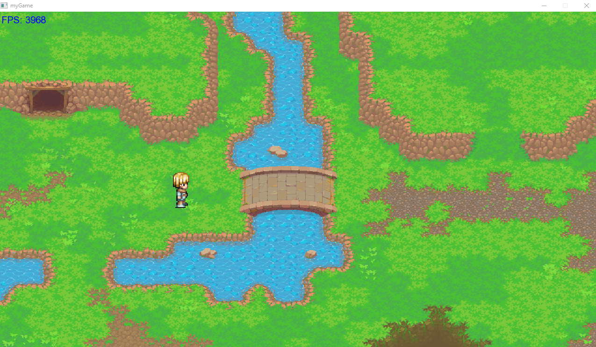
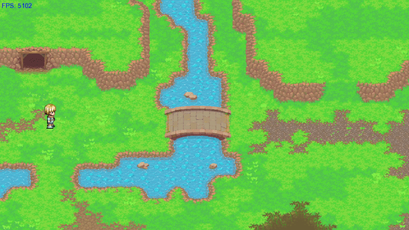

# SFML Multiplayer Game

A C++ game project built with SFML. It combines a graphical, tile based game client with a separate server process and a small message serialization layer for exchanging player input and state.

<!-- Add a project banner or title screen image here. -->

## Screenshots

<!-- Replace the placeholders with screenshots or GIFs when ready. -->

| Game view | Player movement / animation | Multiplayer view |
| --- | --- | --- |
|  |  | |

## About the project

The game client creates an SFML window, loads map data and visual assets, gathers local player input, and displays the map and player characters. The camera view follows the local player. Player positions are represented as state data and associated with player IDs, so the client can keep track of more than one player.

Movement is processed through the client/server flow: the client sends movement input, the server updates player state, and the client reads the returned state to update player positions and movement animations. The project history also includes work on handling multiple client connections. The exact current multiplayer limitations and intended session setup should be documented after confirming them against a runnable build.

The player visuals are assembled from layered character sprites (body, hair, and armour). The animation code includes idle, walking, and running states, with directional movement states. Map code builds a tile map from loaded map data and supports tile animation data.

<!-- Add the game premise, player objective, world / setting, and any rules here. -->

## Features represented in the code

- SFML game window, rendering loop, and camera view that follows the local player
- Tile map loading and map rendering
- Layered player appearance using body, hair, and armour sprites
- Player movement state and directional idle, walk, and run animations
- Player IDs and player position state
- Separate game client and server executable
- Client/server exchange of movement input and player state
- Packet reading, writing, and message serialization components

This list describes systems present in the supplied project history; it does not imply that every feature is complete or polished.

## Controls

<!-- Add the confirmed key bindings here. -->

## Build and run

The supplied project history shows a CMake configuration for C++20, SFML 3.0, and `nlohmann_json`. It defines a `game` target and a `server_exec` target, and includes asset copying as part of the build configuration.

<!-- Add verified setup steps and exact commands for your platform. Include how to launch the server and connect one or more clients. -->

## Project structure

The source history groups the code into these areas:

- `Game.cpp` / `Game.hpp` — game setup, update and render loop
- `map/` — tile, tile-map, map-loading, and map-related code
- `player/` — player state, animation, collider, and collision management
- `texture/` — texture, sprite, and manager classes
- `networkl/client/` — client connection and input handling
- `networkl/server/` — server logic and server executable
- `networkl/serializationlayer/` — packet readers/writers, message handling, and payload schemas
- `assets/` — runtime visual and map assets referenced by the game

<!-- Adjust names and paths if the current repository layout differs. -->

## Current status

<!-- Summarize what currently works, what is being developed, and known issues. -->

## Development notes

<!-- Add setup notes, contribution guidance, or links to planning documents if useful. -->

## License

<!-- Add the license name and link once one has been selected. -->
